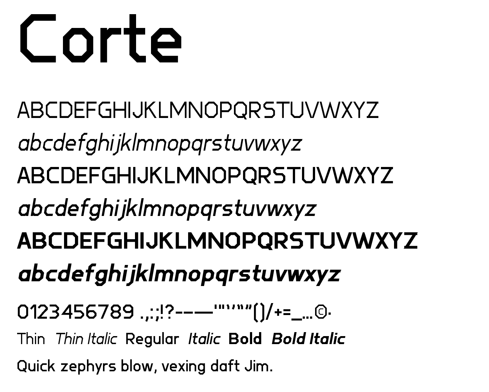

# Corte

Corte is an original sans-serif typeface built from straight strokes, flat ends, and cut corners. It holds its shape at large sizes and stays clear in short lines of display text.

Six styles: **Thin**, **Thin Italic**, **Regular**, **Italic**, **Bold**, **Bold Italic**.

Designed by **[Hasan Ovi](https://github.com/iamovi)**.



---

## Styles

| Style       | `font-weight` | `font-style` | File                  |
| ----------- | ------------- | ------------ | --------------------- |
| Thin        | 300           | normal       | `Corte-Thin`          |
| Thin Italic | 300           | italic       | `Corte-ThinItalic`    |
| Regular     | 400           | normal       | `Corte-Regular`       |
| Italic      | 400           | italic       | `Corte-Italic`        |
| Bold        | 700           | normal       | `Corte-Bold`          |
| Bold Italic | 700           | italic       | `Corte-BoldItalic`    |

Each style ships as `.woff2` (web) and `.ttf` (desktop install).

Character set: `A–Z`, `a–z`, `0–9`, common punctuation (including en and em dashes, curly quotes and the ellipsis), `©` and `·`.

---

## Quick CDN Setup

Add this line directly into your HTML `<head>`. It declares all six styles; the browser only downloads the ones your page actually uses.

```html
<link rel="stylesheet" href="https://cdn.jsdelivr.net/gh/iamovi/corte@1.2.0/css/corte.css">
```

Apply it in your CSS:

```css
body {
  font-family: "Corte", sans-serif;
  font-synthesis: none; /* never fake bold or italic */
}

h1, strong { font-weight: 700; }
.thin      { font-weight: 300; }
em         { font-style: italic; }
.note      { font-weight: 700; font-style: italic; } /* Bold Italic */
```

---

## Self-Hosting

1. Copy the `fonts/` folder and `css/corte.css` to your project.
2. Link the stylesheet, or paste the `@font-face` rules into your own CSS:

```css
@font-face {
  font-family: "Corte";
  src: url("fonts/Corte-Thin.woff2") format("woff2"),
       url("fonts/Corte-Thin.ttf") format("truetype");
  font-weight: 300;
  font-style: normal;
  font-display: swap;
}
@font-face {
  font-family: "Corte";
  src: url("fonts/Corte-ThinItalic.woff2") format("woff2"),
       url("fonts/Corte-ThinItalic.ttf") format("truetype");
  font-weight: 300;
  font-style: italic;
  font-display: swap;
}
@font-face {
  font-family: "Corte";
  src: url("fonts/Corte-Regular.woff2") format("woff2"),
       url("fonts/Corte-Regular.ttf") format("truetype");
  font-weight: 400;
  font-style: normal;
  font-display: swap;
}
@font-face {
  font-family: "Corte";
  src: url("fonts/Corte-Italic.woff2") format("woff2"),
       url("fonts/Corte-Italic.ttf") format("truetype");
  font-weight: 400;
  font-style: italic;
  font-display: swap;
}
@font-face {
  font-family: "Corte";
  src: url("fonts/Corte-Bold.woff2") format("woff2"),
       url("fonts/Corte-Bold.ttf") format("truetype");
  font-weight: 700;
  font-style: normal;
  font-display: swap;
}
@font-face {
  font-family: "Corte";
  src: url("fonts/Corte-BoldItalic.woff2") format("woff2"),
       url("fonts/Corte-BoldItalic.ttf") format("truetype");
  font-weight: 700;
  font-style: italic;
  font-display: swap;
}
```

---

## Install on your computer

Open the `.ttf` files and install them. Apps list the family as **Corte** with Thin, Thin Italic, Regular, Italic, Bold and Bold Italic.

---

## Live Specimen

Test the font in your browser:  
[https://iamovi.github.io/corte/](https://iamovi.github.io/corte/)

---

## Building the styles

Regular is the master. Thin, Italic, Bold and Bold Italic are generated from it, and the copyright and license notice are written into each font's `name` table. Builds are byte-reproducible.

```bash
pip install fonttools brotli numpy shapely
python tools/build_styles.py
```

- **Thin** narrows the outlines (stems 96 → 72 units) while keeping baseline, x-height, cap height, ascender and descender in place.
- **Bold** grows the outlines (stems 96 → 136 units) with the same vertical metrics.
- **Italic** is Regular slanted 10° (a slanted roman, not redrawn letterforms). **Thin Italic** is Thin slanted 10°, **Bold Italic** is Bold slanted 10°.

---

## License

Copyright (c) 2026, Hasan Ovi, with Reserved Font Name "Corte".

Released under the [SIL Open Font License 1.1](LICENSE). Free for personal and commercial use. The copyright notice and license are also embedded in every font file's metadata (name IDs 0, 13 and 14).
